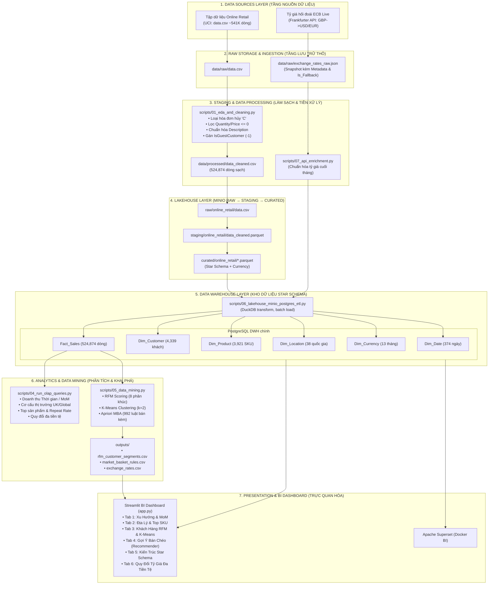

# BÁO CÁO TỔNG KẾT ĐỒ ÁN
# XÂY DỰNG KHO DỮ LIỆU & PHÂN TÍCH KINH DOANH BÁN LẺ
### (ONLINE RETAIL DATA WAREHOUSE & BUSINESS INTELLIGENCE)

---

## MỤC LỤC
1. [GIỚI THIỆU ĐỀ TÀI & TẬP DỮ LIỆU](#1-giới-thiệu-đề-tài--tập-dữ-liệu)
2. [GIAI ĐOẠN 1: KHÁM PHÁ (EDA) & LÀM SẠCH DỮ LIỆU](#2-giai-đoạn-1-khám-phá-eda--làm-sạch-dữ-liệu)
3. [GIAI ĐOẠN 2: THIẾT KẾ MÔ HÌNH DỮ LIỆU ĐA CHIỀU (STAR SCHEMA)](#3-giai-đoạn-2-thiết-kế-mô-hình-dữ-liệu-đa-chiều-star-schema)
4. [GIAI ĐOẠN 3: XÂY DỰNG ĐƯỜNG ỐNG ETL (ETL PIPELINE)](#4-giai-đoạn-3-xây-dựng-đường-ống-etl-etl-pipeline)
5. [GIAI ĐOẠN 4: TRUY VẤN PHÂN TÍCH ĐA CHIỀU (OLAP & ADVANCED SQL)](#5-giai-đoạn-4-truy-vấn-phân-tích-đa-chiều-olap--advanced-sql)
6. [GIAI ĐOẠN 5: KHAI PHÁ DỮ LIỆU CHUYÊN SÂU (DATA MINING & ML)](#6-giai-đoạn-5-khai-phá-dữ-liệu-chuyên-sâu-data-mining--ml)
7. [GIAI ĐOẠN 6: TRỰC QUAN HÓA DASHBOARD (STREAMLIT BI)](#7-giai-đoạn-6-trực-quan-hóa-dashboard-streamlit-bi)
8. [KẾT LUẬN & ĐỀ XUẤT HƯỚNG MỞ RỘNG](#8-kết-luận--đề-xuất-hướng-mở-rộng)
9. [PHỤ LỤC: THÔNG TIN NHÓM VÀ KHAI BÁO AI](#9-phụ-lục-thông-tin-nhóm-và-khai-báo-ai)

---

## 1. GIỚI THIỆU ĐỀ TÀI & TẬP DỮ LIỆU

### 1.1. Bối cảnh bài toán
Trong kỷ nguyên số, các doanh nghiệp bán lẻ trực tuyến (E-commerce) phải đối mặt với lượng dữ liệu giao dịch khổng lồ và phân mảnh. Để tối ưu hóa hiệu quả kinh doanh, việc xây dựng một **Kho Dữ Liệu (Data Warehouse - DWH)** tập trung và triển khai các mô hình phân tích kinh doanh (Business Intelligence - BI) là yêu cầu sống còn.

### 1.2. Tập dữ liệu nghiên cứu & Nguồn gốc học thuật
- **Nguồn dữ liệu chính**: `data.csv` (Online Retail Dataset).
  - **Nguồn gốc học thuật**: Được cung cấp bởi **Dr. Daqing Chen** (Director of Public Analytics Group, School of Engineering, London South Bank University, UK).
  - **Kho lưu trữ chính thức**: [UCI Machine Learning Repository: Online Retail Dataset](https://archive.ics.uci.edu/dataset/352/online+retail).
  - **Giấy phép sử dụng (License)**: Creative Commons Attribution 4.0 International (CC BY 4.0); cần ghi công nguồn theo điều khoản giấy phép.
  - **Thời gian bao phủ**: Từ **01/12/2010** đến **09/12/2011** (1 năm 1 tuần).
  - **Quy mô ban đầu**: `541,909` dòng giao dịch với 8 thuộc tính thô.
- **Nguồn dữ liệu bổ trợ (Enrichment Source)**: 
  - **Dữ liệu**: Tỷ giá hối đoái ngoại tệ (GBP sang USD và EUR).
  - **Nguồn API**: [Frankfurter API](https://api.frankfurter.app) tích hợp từ **Ngân hàng Trung ương Châu Âu (European Central Bank - ECB)**.
  - **Giấy phép & Truy cập**: Open-source, miễn phí, không yêu cầu API key, cung cấp dữ liệu tham chiếu chính thức hàng ngày.

### 1.3. Từ điển dữ liệu nguồn thô (Raw Data Dictionary)
Bảng thông số kỹ thuật của tập dữ liệu giao dịch thô ban đầu trước khi qua xử lý:

| Tên trường (Field) | Kiểu dữ liệu gốc | Cho phép NULL? | Đơn vị đo | Mô tả nghiệp vụ |
|---|---|:---:|---|---|
| `InvoiceNo` | String / Object | Không | Mã định danh | Số hóa đơn gồm 6 chữ số. Nếu bắt đầu bằng `'C'`, đây là hóa đơn hủy (Cancellation). |
| `StockCode` | String / Object | Không | Mã định danh | Mã sản phẩm lưu kho (SKU - Stock Keeping Unit) gồm 5 hoặc 6 ký tự số/chữ. |
| `Description` | String / Object | **Có (0.27%)** | Chuỗi văn bản | Tên và mô tả mặt hàng quà tặng lưu niệm bằng tiếng Anh. |
| `Quantity` | Integer | Không | Sản phẩm (Pcs) | Số lượng hàng hóa được đặt mua trên mỗi dòng hóa đơn. Giá trị âm đại diện cho hàng hoàn/hủy. |
| `InvoiceDate` | String / Datetime | Không | Thời gian | Thời điểm xuất hóa đơn giao dịch (định dạng: `MM/DD/YYYY HH:MM`). |
| `UnitPrice` | Float / Decimal | Không | Bảng Anh (£ GBP) | Đơn giá niêm yết bán lẻ trên mỗi đơn vị sản phẩm. |
| `CustomerID` | Float / Number | **Có (24.93%)** | Mã số nguyên | Mã định danh 5 chữ số của khách hàng đã đăng ký tài khoản. Giá trị NULL đại diện cho khách vãng lai. |
| `Country` | String / Object | Không | Tên địa danh | Tên quốc gia nơi khách hàng cư trú hoặc đặt hàng vận chuyển đến. |

### 1.4. Quy chuẩn xử lý API Ingestion & Nguyên tắc truy xuất nguồn gốc (Data Lineage)
Trong thiết kế Kho Dữ Liệu hiện đại, việc gọi API ngoài không nên nạp thẳng một chiều vào Fact/Dim mà phải tuân thủ chuẩn **Auditable Data Lineage**:
1. **Lưu trữ bản trích xuất thô (Raw Snapshot)**: Toàn bộ phản hồi API dạng JSON được snapshot lưu trữ tại `data/raw/exchange_rates_raw.json` kèm các siêu dữ liệu (metadata):
   - `extracted_at`: Thời điểm gửi request (ISO 8601 UTC).
   - `endpoint` & `params`: URL và tham số gọi API (`from=GBP&to=USD,EUR`).
   - `status` & `record_count`: Trạng thái phản hồi HTTP và số lượng bản ghi nhận được.
2. **Minh bạch hóa dữ liệu dự phòng (Fallback Provenance)**:
   - Nếu kết nối internet hoặc API gặp sự cố, hệ thống chuyển sang chế độ dự phòng (Offline Fallback Benchmark).
   - Để tránh nhầm lẫn giữa dữ liệu ECB thực tế và tỷ giá ước lượng, trường `Is_Fallback` (0: Real Live ECB, 1: Fallback) và `API_Source` được lưu tường minh vào bảng `Dim_Currency` trong DWH.
3. **Quy trình luân chuyển dữ liệu**:
   $$\text{Frankfurter API (ECB)} \longrightarrow \text{Raw Snapshot (JSON)} \longrightarrow \text{EDA \& Transform} \longrightarrow \text{Dim\_Currency (DWH)} \longrightarrow \text{OLAP Multi-Currency}$$

### 1.5. Sơ đồ kiến trúc luồng dữ liệu tổng thể (End-to-End Data Lineage Architecture)
Hệ thống kết nối luồng dữ liệu đa nguồn từ trích xuất đến trình diễn theo sơ đồ dưới đây:

---

## 2. GIAI ĐOẠN 1: KHÁM PHÁ (EDA) & LÀM SẠCH DỮ LIỆU

Script thực hiện: `scripts/01_eda_and_cleaning.py`.

### 2.1. Đánh giá chất lượng dữ liệu nguồn
- **Giá trị khuyết thiếu**:
  - `CustomerID`: Thiếu **135,080** bản ghi (~24.93%) do khách hàng vãng lai (Guest Checkout) không tạo tài khoản.
  - `Description`: Thiếu **1,454** bản ghi (~0.27%).
- **Dị biệt nghiệp vụ**:
  - Phát hiện **5,268** bản ghi trùng lặp tuyệt đối; chỉ giữ bản ghi đầu tiên.
  - Sau khi xử lý trùng, loại **9,251** dòng thuộc hóa đơn hủy, **1,336** dòng có `Quantity <= 0`, và **1,180** dòng có `UnitPrice <= 0`.
  - Có **1,454** dòng thiếu `Description`; mô tả được khôi phục theo `StockCode` khi có ánh xạ, các trường hợp còn lại được gắn `UNKNOWN DESCRIPTION`.

### 2.2. Chiến lược xử lý & Làm sạch
1. Loại bản ghi trùng tuyệt đối, hóa đơn hủy và giao dịch có số lượng/đơn giá không dương; lưu riêng dữ liệu bị loại kèm lý do trong `data/processed/data_rejected.csv`.
2. Chuẩn hóa chuỗi mô tả `Description` (viết hoa, bỏ khoảng trắng thừa); khôi phục mô tả thiếu theo `StockCode` khi có thể.
3. Chuẩn hóa `CustomerID`: gán mã `-1` và cờ `IsGuestCustomer = 1` cho khách vãng lai, giữ giao dịch cho doanh thu nhưng loại khỏi RFM.
4. Tính `LineRevenue = Quantity × UnitPrice` sau khi chuẩn hóa giá và tạo thuộc tính thời gian (`Year`, `Month`, `Day`, `Hour`, `DayOfWeek`).
- **Kết quả**: **524,874** dòng sạch (96.86% dữ liệu ban đầu), doanh thu **£10,642,110.80**, lưu tại `data/processed/data_cleaned.csv`. Audit waterfall được lưu tại `outputs/data_cleaning_audit.csv`.

---

## 3. GIAI ĐOẠN 2: THIẾT KẾ MÔ HÌNH DỮ LIỆU ĐA CHIỀU (STAR SCHEMA)

Tài liệu thiết kế: `database/02_data_modeling.md` | DDL Schema: `database/02_schema_ddl.sql`.

### 3.1. Phương pháp luận Ralph Kimball 4 bước
1. **Quy trình nghiệp vụ**: Bán lẻ trực tuyến (Retail Sales Transactions).
2. **Độ hạt (Granularity)**: Từng dòng mặt hàng trong mỗi hóa đơn (Line-item level).
3. **Các chiều phân tích (Dimensions)**:
   - `Dim_Date`: Quản lý 374 ngày dương lịch (Ngày, Tháng, Quý, Năm, Ngày trong tuần, Cuối tuần).
   - `Dim_Customer`: 4,339 khách hàng (Khóa đại diện `CustomerKey`, `CustomerID`, phân loại Guest).
   - `Dim_Product`: 3,921 mặt hàng (`StockCode`, `Description`, `UnitPrice_Standard`).
   - `Dim_Location`: 38 quốc gia (`Country`, phân loại vùng: Vương quốc Anh vs Quốc tế).
   - `Dữ liệu mở rộng E-Commerce API`: Kết nối danh mục và đánh giá từ **DummyJSON E-Commerce REST API** (194 sản phẩm, 24 ngành hàng) để hỗ trợ phân cấp ngành hàng và chuẩn hóa chất lượng sản phẩm.
4. **Bảng sự kiện (Fact Table)**:
   - `Fact_Sales`: 524,874 bản ghi.
   - Các độ đo (Measures): `Quantity`, `UnitPrice`, `TotalRevenue` (= Quantity * UnitPrice).
   - Chiều thoái hóa (Degenerate Dimension): `InvoiceNo` phục vụ gom nhóm giỏ hàng.

---

## 4. GIAI ĐOẠN 3: LAKEHOUSE VÀ ĐƯỜNG ỐNG ETL

Script thực hiện: `scripts/06_lakehouse_minio_postgres_etl.py`.

### 4.1. Quy trình Lakehouse ETL
- **Raw**: Đưa CSV nguồn và snapshot API lên bucket `raw` của MinIO trước khi xử lý dữ liệu.
- **EDA & Cleaning**: Đọc lại CSV raw từ MinIO, chạy `scripts/01_eda_and_cleaning.py`; lưu bản sạch, bản bị loại và audit cục bộ để kiểm tra/đối soát.
- **Staging**: Chuyển dữ liệu sạch thành Parquet, lưu tại `staging`.
- **Curated**: Dùng DuckDB đọc lại Parquet staging, tạo các bảng Star Schema dạng Parquet và lưu tại `curated`.
- **Load**: Đọc lại các object curated từ MinIO rồi nạp theo lô, trong một transaction, vào PostgreSQL DWH.
- **SQLite**: Giữ `scripts/03_etl_pipeline.py` làm luồng local/dự phòng; không phải nguồn dữ liệu cho các bước chính.

### 4.2. Kiểm thử tính toàn vẹn (Integrity & Reconciliation)
- **Ràng buộc khóa ngoại**: **0 lỗi mồ côi** (100% dòng Fact khớp hoàn hảo với 4 bảng Dim).
- **Kiểm thử và đối soát PostgreSQL**: Bộ kiểm thử tự động hiện có **28/28 đạt**, gồm đối chiếu số dòng, tổng số lượng, doanh thu, khóa ngoại, quy tắc nghiệp vụ, các lát cắt và đối soát doanh thu của ba khối tổng hợp.
  - Doanh thu dữ liệu sạch: **£10,642,110.80**.
  - Doanh thu `Fact_Sales`: **£10,642,110.80** (sai lệch **£0.00** ở độ chính xác 2 chữ số thập phân).

---

## 5. GIAI ĐOẠN 4: TRUY VẤN PHÂN TÍCH ĐA CHIỀU (OLAP & ADVANCED SQL)

Script thực hiện: `sql/04_olap_queries.sql` và `scripts/04_run_olap_queries.py`.

### 5.1. Các kỹ thuật SQL nâng cao áp dụng
- **Window Functions**: `LAG()`, `RANK()`, `DENSE_RANK()`, `SUM() OVER(PARTITION BY...)`.
- **Mô phỏng đa cấp ROLLUP**: Kết hợp CTE và `UNION ALL` để tổng hợp 3 cấp độ (Năm -> Quý -> Tháng).
- **Hai khối tổng hợp tối thiểu**: `mv_olap_monthly_sales` (năm-tháng) và `mv_olap_monthly_country_sales` (năm-tháng-quốc gia), được ETL refresh sau mỗi lần nạp. Khối thứ ba `mv_olap_monthly_product_sales` phục vụ truy vấn sản phẩm theo thời gian. DDL: `sql/05_olap_aggregate_cubes.sql`.
- **Năm thao tác OLAP**: `scripts/04_run_olap_queries.py` trình diễn Slice (năm 2011), Dice (quý 4 của UK/Đức), Drill-down (năm đến tháng), Roll-up (tháng lên quý) và Pivot (quốc gia thành cột). Chạy sau ETL để xem kết quả trên dữ liệu hiện tại.

### 5.2. Các phát hiện kinh doanh then chốt
1. **Xu hướng mùa vụ**: Doanh thu đạt đỉnh vào **Tháng 11/2011 (£1,503,866.78)**, tăng trưởng MoM **+30.63%**; đây là quan sát trong dữ liệu, phù hợp với mùa mua sắm cuối năm.
2. **Cơ cấu thị trường**: Vương quốc Anh chiếm **84.59%** doanh thu. Các thị trường quốc tế đóng góp cao gồm Hà Lan (2.68%), EIRE (2.66%) và Đức (2.15%).
3. **Khung giờ vàng mua sắm**: Tập trung cao độ từ **10:00 sáng đến 15:00 chiều**, đỉnh cao là **12:00 trưa** (3,220 đơn hàng).
4. **Tỷ lệ khách hàng quay lại (Repeat Customer Rate)**: Đạt **65.58%** (2,845 / 4,338 khách hàng định danh mua từ 2 lần trở lên).
5. **Tích hợp API Thương mại điện tử (DummyJSON E-Commerce REST API)**: Kết nối trực tiếp 194 sản phẩm và 24 danh mục ngành hàng, đánh giá trung bình 3.86 ★, đối soát chuẩn hóa danh mục ngành hàng cho dữ liệu bán lẻ DWH.

---

## 6. GIAI ĐOẠN 5: KHAI PHÁ DỮ LIỆU CHUYÊN SÂU (DATA MINING & ML)

Script thực hiện: `scripts/05_data_mining.py`.

### 6.1. Mô hình Phân khúc Khách hàng RFM & K-Means
- **Chỉ số RFM**:
  - `Recency (R)`: Trung bình 92.5 ngày.
  - `Frequency (F)`: Trung bình 4.27 đơn hàng (cao nhất 209 đơn).
  - `Monetary (M)`: Trung bình 2,048.69 GBP/khách (cao nhất 280,206.02 GBP).
- **Phân nhóm khách hàng (Thuần tiếng Việt)**:
  - **Khách hàng VIP**: 957 khách hàng (~22%), tổng chi tiêu **£5,791,640.74**, trung bình **£6,051.87/khách** (chiếm hơn 54% tổng doanh thu).
  - **Khách hàng trung thành**: 764 khách hàng, chi tiêu trung bình **£1,827.90/khách**.
  - **Có nguy cơ rời bỏ**: 442 khách hàng (nguy cơ rời bỏ).
  - **Ngủ đông / Đã rời bỏ**: 1,065 khách hàng.
  - Cùng các nhóm: *Khách mới & Tiềm năng, Khách hàng triển vọng, Cần quan tâm chăm sóc, Khách VIP cần giữ chân*.
- **Phân cụm K-Means**: Tách holdout ngẫu nhiên 80/20 theo khách hàng (seed 42), fit scaler trên train; so sánh K=2..8 của K-Means log-RFM với baseline K-Means RFM chưa log-transform. Cả hai được đánh giá trong cùng không gian log-RFM chuẩn hóa; chọn cấu hình bằng Silhouette train, còn Silhouette holdout chỉ dùng báo cáo. Kết quả chạy hiện tại chọn baseline K-Means RFM thô, K=2 (train **0.5949**, holdout **0.6010**) so với K-Means log-RFM K=2 (train **0.4327**, holdout **0.4331**). Mô hình được chọn được fit lại trên toàn bộ khách hàng và kiểm tra độ ổn định qua 5 random seeds (đồng thuận 100%).
- File kết quả: `outputs/rfm_customer_segments.csv`.
- **Giới hạn diễn giải**: Silhouette và độ ổn định không chứng minh phân khúc làm tăng doanh thu; cần kiểm tra hồ sơ từng cụm và xác nhận với nghiệp vụ trước khi triển khai chiến dịch.

### 6.2. Phân tích Giỏ hàng (Market Basket Analysis - Apriori)
- **Tập giao dịch**: 18,275 đơn hàng đa sản phẩm, 3,775 sản phẩm sau loại trừ các dòng phí/phi sản phẩm.
- **Thuật toán Apriori**: Ngưỡng `min_support = 1.5%` phát hiện 912 tập mục phổ biến và sinh ra **992 luật kết hợp** có `Lift >= 1.2`.
- **Luật bán kèm tiêu biểu (Cross-selling)**:
  - Khách mua `Đĩa trà Regency màu hồng` -> Gợi ý mua `Đĩa trà Regency màu xanh lá` (**Độ tin cậy: 91.15%, Hệ số Lift: 43.83 lần**).
  - Khách mua `Nhà búp bê Poppy - Phòng ngủ` -> Gợi ý mua `Nhà búp bê Poppy - Nhà bếp` (**Độ tin cậy: 74.00%, Hệ số Lift: 31.02 lần**).
  - Khách mua `Bộ 6 cốc giấy chấm bi đỏ` -> Gợi ý mua `Bộ 6 đĩa giấy chấm bi đỏ` (**Độ tin cậy: 82.16%, Hệ số Lift: 28.49 lần**).
- File kết quả: `outputs/market_basket_rules.csv`.

---

## 7. GIAI ĐOẠN 6: TRỰC QUAN HÓA DASHBOARD (STREAMLIT BI)

Ứng dụng web: `app.py` (Chạy bằng lệnh: `streamlit run app.py`).

### Các tính năng chính trên Dashboard:
1. **Executive KPI Cards**: Hiển thị doanh thu tổng (**£10.64M**), tổng đơn, Giá trị đơn hàng trung bình (**£533.17**) và số khách định danh (**4,338**).
2. **Tab 1 - Xu hướng Doanh thu**: Biểu đồ kết hợp Bar-Line thể hiện doanh thu, số đơn và tỷ lệ tăng trưởng MoM theo tháng, phân tích khung giờ cao điểm.
3. **Tab 2 - Thị Trường & Sản Phẩm**: Biểu đồ phân bổ tỷ trọng doanh thu Vương quốc Anh vs Quốc tế, Top 10 sản phẩm bán chạy nhất về số lượng và doanh thu bằng tên tiếng Việt.
4. **Tab 3 - Phân Khúc Khách Hàng**: Biểu đồ Treemap doanh thu theo phân khúc RFM, biểu đồ phân tán K-Means và danh sách Top Khách hàng VIP.
5. **Tab 4 - Gợi Ý Bán Chéo Giỏ Hàng**: Công cụ chọn 1 sản phẩm -> tự động gợi ý các sản phẩm đi kèm theo điểm Lift và Độ tin cậy (Confidence).
6. **Tab 5 - Kiến Trúc Kho Dữ Liệu**: Sơ đồ Star Schema và bảng thống kê thực tế các bảng DWH.
7. **Tab 6 - Tích Hợp API Thương Mại Điện Tử**: Kết nối thời gian thực tới DummyJSON E-Commerce REST API, hiển thị chỉ số ngành hàng, đánh giá người dùng (Rating ★) và tra cứu sản phẩm trực tiếp.

---

## 8. KẾT LUẬN & ĐỀ XUẤT HƯỚNG MỞ RỘNG

### 8.1. Kết luận
Đồ án hiện có luồng dữ liệu từ MinIO qua PostgreSQL DWH đến phân tích OLAP, khai phá và dashboard. Các materialized views và ví dụ năm thao tác OLAP được tạo/cập nhật tự động khi chạy ETL; phần đánh giá K-Means có baseline và holdout. Nhóm cần chạy lại quy trình trên máy sạch, lưu kết quả kiểm thử và hoàn thiện các thông tin đóng góp/trình bày thực tế trong phụ lục trước khi nộp.

### 8.2. Đề xuất hướng phát triển mở rộng
1. **Kiến trúc Data Lakehouse trên Đám mây**: Mở rộng lưu trữ trên Snowflake hoặc Google BigQuery để đáp ứng khối lượng dữ liệu hàng trăm triệu dòng.
2. **Đường ống thời gian thực (Real-time Streaming ETL)**: Tích hợp Apache Kafka và Apache Spark Streaming để xử lý đơn hàng theo thời gian thực (Near Real-Time Analytics).
3. **Mô hình học máy dự báo (Predictive Analytics)**: Xây dựng thêm mô hình dự báo doanh thu chuỗi thời gian (ARIMA / Prophet / XGBoost) và dự đoán tỷ lệ khách hàng rời bỏ (Customer Churn Prediction).

## 9. PHỤ LỤC: THÔNG TIN NHÓM VÀ KHAI BÁO AI

> Nhóm cần điền tên, phần việc và minh chứng dựa trên đóng góp thực tế. Không giữ dòng mẫu
> hoặc khai báo thay cho thành viên nếu chưa xác nhận.

| Thành viên | Phần việc chính | Minh chứng/đầu ra | Phần trình bày |
|---|---|---|---|
| [Điền tên] | [Điền theo phân công thực tế] | [File/commit/kiểm thử đã thực hiện] | [Nội dung trình bày] |
| [Thêm dòng theo số thành viên thực tế] | | | |

**Mẫu khai báo công cụ AI (cần nhóm xác nhận và chỉnh theo thực tế):**
Trong quá trình hoàn thiện dự án, nhóm có sử dụng công cụ AI để hỗ trợ gợi ý,
debug và biên tập tài liệu/mã nguồn. Nhóm chịu trách nhiệm kiểm tra, chạy thử và
xác nhận nội dung bàn giao; mọi phần sử dụng AI cần được đối chiếu với quy định môn
học. Nhóm cần ghi rõ công cụ và phạm vi sử dụng thực tế nếu giảng viên yêu cầu.
