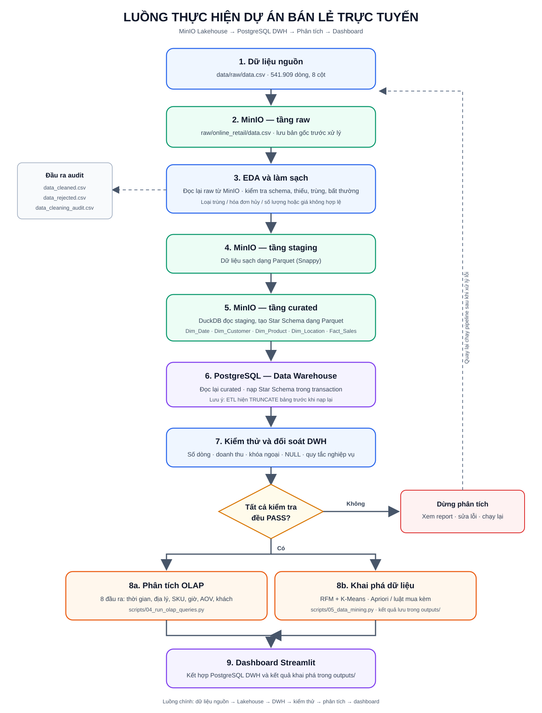
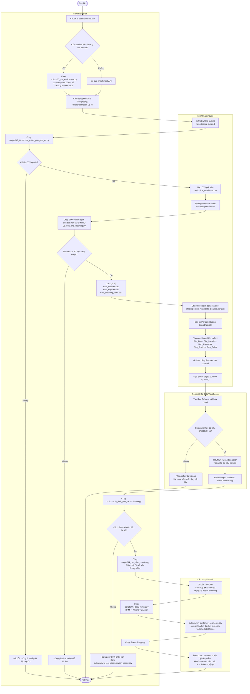

# Sơ đồ hoạt động dự án

## Mục đích

Sơ đồ mô tả luồng thực hiện dự án từ dữ liệu bán lẻ gốc đến Lakehouse, kho dữ liệu,
kiểm thử, phân tích và dashboard. Đây là luồng batch hiện tại của dự án; SQLite là
phương án dự phòng, không nằm trong luồng chính.

## Activity diagram

### Sơ đồ trực quan



Sơ đồ trên là bản rút gọn để dễ theo dõi khi thuyết trình. Mã Mermaid chi tiết bên dưới
thể hiện thêm các nhánh lỗi và thành phần xử lý.



## Giải thích các hoạt động

1. **Chuẩn bị nguồn và hạ tầng:** dữ liệu giao dịch cần có tại `data/raw/data.csv`.
   Khởi động MinIO và PostgreSQL bằng Docker Compose. Bước tỷ giá qua API là tùy chọn.
2. **Nạp raw trước khi làm sạch:** ETL đưa CSV gốc vào bucket `raw`, sau đó đọc lại
   object từ MinIO để làm EDA và làm sạch. Các dòng bị loại được giữ kèm lý do; báo cáo
   audit hỗ trợ đối soát.
3. **Biến đổi qua Lakehouse:** dữ liệu sạch được ghi dạng Parquet vào `staging`.
   DuckDB đọc lại staging, tạo các bảng chiều và fact, rồi lưu vào `curated`.
4. **Nạp DWH:** pipeline đọc lại các object curated và nạp chúng vào Star Schema
   PostgreSQL. **Lưu ý:** ETL hiện `TRUNCATE` các bảng đích trước khi nạp lại; chỉ tiếp tục
   khi chấp nhận thay thế dữ liệu đang có.
5. **Kiểm thử trước phân tích:** bộ reconciliation kiểm tra số dòng, số lượng, doanh thu,
   khóa ngoại, giá trị NULL và quy tắc nghiệp vụ. Nếu có kiểm tra `FAIL`, cần dừng và xem
   báo cáo trước khi chạy OLAP hoặc khai phá.
6. **Phân tích và trình bày:** OLAP chạy trên PostgreSQL; RFM/K-Means và Apriori tạo các
   tệp kết quả trong `outputs/`. Dashboard Streamlit đọc dữ liệu DWH và các kết quả khai
   phá đã tính trước.

## Mười đầu ra OLAP

Script có 9 nhãn “BÀI TOÁN”; bài toán 3 gồm hai truy vấn riêng, nên tổng cộng có 10 đầu
ra phân tích:

1. Doanh thu theo tháng, tăng trưởng MoM và lũy kế YTD.
2. Thị trường địa lý và tỷ trọng doanh thu theo quốc gia.
3. Top 10 sản phẩm theo số lượng bán.
4. Top 10 sản phẩm theo doanh thu.
5. Phân bố giao dịch theo khung giờ.
6. AOV và quy mô giỏ hàng theo tháng.
7. Tỷ lệ khách hàng quay lại.
8. Top khách hàng VIP theo doanh thu.
9. Doanh thu quy đổi GBP, USD và EUR.
10. Biến động tỷ giá theo tháng.

## Lời trình bày ngắn

> Đầu tiên, nhóm lưu bản dữ liệu gốc vào MinIO raw để giữ nguyên nguồn. Pipeline đọc
> lại bản raw này để kiểm tra và làm sạch, đồng thời lưu riêng dữ liệu sạch, dữ liệu bị
> loại và báo cáo audit. Dữ liệu sạch được chuyển thành Parquet ở staging; từ staging,
> nhóm xây dựng các bảng chiều và fact ở curated rồi nạp vào PostgreSQL theo mô hình
> Star Schema. Sau khi đối soát DWH đạt yêu cầu, nhóm chạy 10 đầu ra OLAP, khai phá
> khách hàng bằng RFM/K-Means, tìm luật mua kèm bằng Apriori và trình bày kết quả trên
> dashboard Streamlit.

## Lệnh chạy luồng chính

```powershell
docker compose up -d minio minio-init postgres
python scripts\06_lakehouse_minio_postgres_etl.py
python scripts\03b_dwh_test_reconciliation.py
python scripts\04_run_olap_queries.py
python scripts\05_data_mining.py
python -m streamlit run app.py
```

Không cần chạy `scripts\01_eda_and_cleaning.py` riêng trước ETL chính; pipeline 06 gọi
bước làm sạch sau khi đã nạp và đọc lại bản raw từ MinIO.
