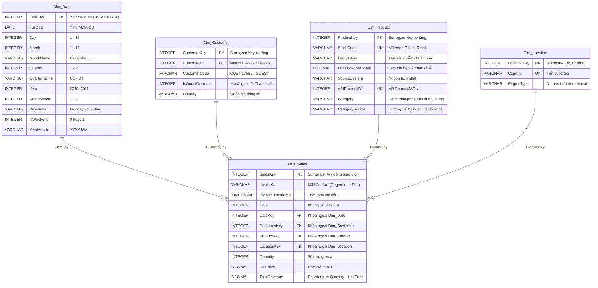

# TÀI LIỆU THIẾT KẾ MÔ HÌNH DỮ LIỆU ĐA CHIỀU (DIMENSIONAL DATA MODELING)
## Đồ án: Kho Dữ Liệu & Phân Tích Kinh Doanh Bán Lẻ (Online Retail DWH)

---

## 1. QUY TRÌNH THIẾT KẾ 4 BƯỚC KIMBALL (KIMBALL'S 4-STEP PROCESS)

Mô hình kho dữ liệu được xây dựng tuân theo phương pháp luận thiết kế chiều của **Ralph Kimball**:

### Bước 1: Lựa chọn Quy trình Nghiệp vụ (Select the Business Process)
- **Quy trình lựa chọn**: **Bán hàng trực tuyến (Online Retail Order Transactions)**.
- Đây là hoạt động kinh doanh cốt lõi của doanh nghiệp, ghi nhận mọi đơn đặt hàng của khách hàng từ website thương mại điện tử, bao gồm thông tin chi tiết về sản phẩm, số lượng, đơn giá và thời điểm xuất hóa đơn.

### Bước 2: Tuyên bố Độ hạt (Declare the Grain)
- **Độ hạt (Granularity)** của bảng Fact là **Từng dòng mặt hàng trong mỗi hóa đơn bán hàng (Individual line-item on a sales invoice)**.
- *Ý nghĩa*: Mỗi bản ghi trong bảng Fact đại diện cho đúng 1 sản phẩm cụ thể được khách hàng mua trong 1 lần xuất hóa đơn. Đây là mức độ hạt chi tiết nhất (Atomic Grain), đảm bảo khả năng tổng hợp (roll-up) linh hoạt theo mọi chiều mà không làm mất thông tin chi tiết.

### Bước 3: Xác định các Chiều Phân tích (Identify the Dimensions)
Các chiều phân tích (Dimensions) trả lời cho câu hỏi: *Ai mua? Mua cái gì? Mua khi nào? Giao dịch tại đâu?*
1. **Dim_Date (Chiều Thời gian)**: Cho phép phân tích theo Ngày, Tháng, Quý, Năm, Ngày trong tuần, Cuối tuần, Khung giờ.
2. **Dim_Customer (Chiều Khách hàng)**: Quản lý khách hàng thành viên và phân loại khách hàng vãng lai (Guest).
3. **Dim_Product (Chiều Sản phẩm)**: Chiều hợp nhất từ giao dịch Online Retail và catalog DummyJSON, gồm mã hàng, mô tả, đơn giá bán lẻ, danh mục phân tích dùng chung và thuộc tính catalog.
4. **Dim_Location (Chiều Địa lý)**: Phân tích theo Quốc gia và vùng miền (Thị trường nội địa Anh vs Thị trường quốc tế).

**Hợp nhất hai nguồn:** DummyJSON Products được nạp vào cùng `Dim_Product` với hàng Online Retail. Bản ghi được nối khi SKU, mã vạch hoặc tên chuẩn hóa khớp tin cậy. Mọi sản phẩm đều có danh mục phân tích dùng chung: catalog giữ danh mục DummyJSON, hàng bán lẻ được gán bằng luật từ khóa. `Fact_Sales` chỉ chứa giao dịch Online Retail; sản phẩm chỉ có trong catalog không được gán hóa đơn giả.

### Bước 4: Xác định các Độ đo / Sự kiện (Identify the Facts & Measures)
- **Measures (Độ đo)**:
  - `Quantity` (Số lượng sản phẩm bán ra - Additive Numeric Measure).
  - `UnitPrice` (Đơn giá giao dịch - Non-additive Measure).
  - `TotalRevenue` (Doanh thu = `Quantity * UnitPrice` - Fully Additive Measure).
- **Degenerate Dimension (Chiều thoái hóa)**:
  - `InvoiceNo`: Mã số hóa đơn được lưu trữ trực tiếp trên bảng Fact để hỗ trợ gom nhóm giao dịch trong Phân tích giỏ hàng (Market Basket Analysis).

---

## 2. SƠ ĐỒ KIẾN TRÚC HÌNH SAO (STAR SCHEMA ERD)

---

## 3. MA TRẬN XE BUÝT DOANH NGHIỆP (ENTERPRISE DATA BUS MATRIX)

| Quy trình nghiệp vụ (Business Process) | Dim_Date | Dim_Customer | Dim_Product | Dim_Location | Ghi chú độ hạt |
| :--- | :---: | :---: | :---: | :---: | :--- |
| **Retail Sales (Bán lẻ)** | **X** | **X** | **X** | **X** | Line-item từng đơn hàng |
| **Customer Retention & RFM** | **X** | **X** | | **X** | Cấp độ Khách hàng (Customer Level) |
| **Market Basket Analysis** | **X** | **X** | **X** | | Cấp độ Hóa đơn (Invoice Level) |

---

## 4. TỪ ĐIỂN DỮ LIỆU CHI TIẾT (DATA DICTIONARY)

### 4.1. Bảng `Dim_Date`
| Tên cột | Kiểu dữ liệu | Khóa | Cho phép NULL | Diễn giải |
| :--- | :--- | :---: | :---: | :--- |
| `DateKey` | INTEGER | **PK** | No | Khóa ngày tháng định dạng số nguyên YYYYMMDD (ví dụ: `20101201`). |
| `FullDate` | DATE | | No | Ngày dương lịch đầy đủ (`2010-12-01`). |
| `Day` | INTEGER | | No | Ngày trong tháng (1 - 31). |
| `Month` | INTEGER | | No | Tháng trong năm (1 - 12). |
| `MonthName` | VARCHAR(20) | | No | Tên tháng bằng tiếng Anh (`December`, `January`,...). |
| `Quarter` | INTEGER | | No | Số thứ tự quý trong năm (1, 2, 3, 4). |
| `QuarterName` | VARCHAR(10) | | No | Tên quý (`Q1`, `Q2`, `Q3`, `Q4`). |
| `Year` | INTEGER | | No | Năm dương lịch (2010, 2011). |
| `DayOfWeek` | INTEGER | | No | Thứ tự ngày trong tuần (1 = Monday, ..., 7 = Sunday). |
| `DayName` | VARCHAR(20) | | No | Tên thứ trong tuần (`Monday`, `Tuesday`,...). |
| `IsWeekend` | INTEGER | | No | Cờ đánh dấu ngày cuối tuần: 1 (Thứ 7 / CN), 0 (Ngày trong tuần). |
| `YearMonth` | VARCHAR(7) | | No | Chuỗi biểu diễn Năm-Tháng (`2010-12`). |

### 4.2. Bảng `Dim_Customer`
| Tên cột | Kiểu dữ liệu | Khóa | Cho phép NULL | Diễn giải |
| :--- | :--- | :---: | :---: | :--- |
| `CustomerKey` | INTEGER | **PK** | No | Khóa đại diện tự tăng (Surrogate Key). |
| `CustomerID` | INTEGER | **UK** | No | Khóa tự nhiên từ nguồn ERP/CRM. Với khách vãng lai, gán giá trị `-1`. |
| `CustomerCode` | VARCHAR(50) | | No | Chuỗi mã khách hiển thị (`CUST-17850`, `GUEST`). |
| `IsGuestCustomer` | INTEGER | | No | 1 nếu là khách vãng lai (không có tài khoản), 0 nếu là thành viên. |
| `Country` | VARCHAR(100) | | Yes | Quốc gia đăng ký ban đầu của khách hàng. |

### 4.3. Bảng `Dim_Product`
| Tên cột | Kiểu dữ liệu | Khóa | Cho phép NULL | Diễn giải |
| :--- | :--- | :---: | :---: | :--- |
| `ProductKey` | INTEGER | **PK** | No | Khóa đại diện tự tăng (Surrogate Key). |
| `StockCode` | VARCHAR(50) | **UK** | Yes | Mã hàng Online Retail; NULL nếu sản phẩm chỉ có trong DummyJSON. |
| `Description` | VARCHAR(255) | | No | Tên/mô tả sản phẩm đã làm sạch. |
| `UnitPrice_Standard` | DECIMAL(10,2) | | Yes | Đơn giá bán tham chiếu của Online Retail. |
| `SourceSystem` | VARCHAR(50) | | No | Nguồn: bán lẻ, DummyJSON, hoặc đã khớp hai nguồn. |
| `APIProductID` | INTEGER | **UK** | Yes | Mã sản phẩm DummyJSON khi có bản ghi catalog. |
| `Category` | VARCHAR(100) | | Yes | Danh mục phân tích dùng chung cho hai nguồn. |
| `CategorySource` | VARCHAR(40) | | Yes | DummyJSON hoặc luật từ khóa bán lẻ. |

### 4.4. Bảng `Dim_Location`
| Tên cột | Kiểu dữ liệu | Khóa | Cho phép NULL | Diễn giải |
| :--- | :--- | :---: | :---: | :--- |
| `LocationKey` | INTEGER | **PK** | No | Khóa đại diện tự tăng (Surrogate Key). |
| `Country` | VARCHAR(100) | **UK** | No | Tên quốc gia phát sinh giao dịch. |
| `RegionType` | VARCHAR(50) | | No | Phân loại thị trường: `Domestic` (UK) hoặc `International` (Quốc tế). |

### 4.5. Bảng `Fact_Sales`
| Tên cột | Kiểu dữ liệu | Khóa | Cho phép NULL | Diễn giải |
| :--- | :--- | :---: | :---: | :--- |
| `SalesKey` | INTEGER | **PK** | No | Khóa định danh dòng giao dịch bán hàng (Surrogate Key). |
| `InvoiceNo` | VARCHAR(20) | | No | Mã số hóa đơn giao dịch (Degenerate Dimension). |
| `InvoiceTimestamp` | TIMESTAMP | | No | Thời điểm chính xác thực hiện giao dịch (`YYYY-MM-DD HH:MM:SS`). |
| `Hour` | INTEGER | | No | Khung giờ giao dịch (0 - 23) phục vụ phân tích giờ vàng mua sắm. |
| `DateKey` | INTEGER | **FK** | No | Khóa ngoại tham chiếu đến `Dim_Date(DateKey)`. |
| `CustomerKey` | INTEGER | **FK** | No | Khóa ngoại tham chiếu đến `Dim_Customer(CustomerKey)`. |
| `ProductKey` | INTEGER | **FK** | No | Khóa ngoại tham chiếu đến `Dim_Product(ProductKey)`. |
| `LocationKey` | INTEGER | **FK** | No | Khóa ngoại tham chiếu đến `Dim_Location(LocationKey)`. |
| `Quantity` | INTEGER | | No | Số lượng đơn vị sản phẩm mua trong dòng này (> 0). |
| `UnitPrice` | DECIMAL(10,2) | | No | Đơn giá thực tế thanh toán tại thời điểm mua (> 0). |
| `TotalRevenue` | DECIMAL(12,2) | | No | Tổng tiền của dòng = `Quantity * UnitPrice`. |

---

## 5. CÁC QUY ƯỚC THIẾT KẾ & TỐI ƯU HÓA

1. **Khóa đại diện (Surrogate Keys)**:
   - Tất cả các bảng Dimension đều sử dụng khóa số nguyên tự tăng (`INTEGER PRIMARY KEY`) độc lập với khóa tự nhiên từ hệ thống nguồn (`CustomerID`, `StockCode`).
   - Giúp tối ưu hóa tốc độ Join bảng, giảm dung lượng chỉ mục và cho phép xử lý dữ liệu lịch sử linh hoạt.
2. **Khóa thoái hóa (Degenerate Dimension)**:
   - Cột `InvoiceNo` được giữ trực tiếp trong bảng Fact mà không cần tạo bảng Dimension riêng cho Invoice, giúp tối ưu hiệu năng và thuận tiện cho việc gom nhóm các mặt hàng trong cùng 1 giỏ hàng.
3. **Chỉ mục hiệu năng cao (Performance Indexing)**:
   - Tạo Index trên toàn bộ các cột Foreign Key trong `Fact_Sales` (`DateKey`, `CustomerKey`, `ProductKey`, `LocationKey`, `InvoiceNo`).
   - Tạo Index hỗn hợp trên `Dim_Date(Year, Month)` để tăng tốc các truy vấn OLAP tổng hợp theo chu kỳ thời gian.

## 6. CÁC KHỐI TỔNG HỢP OLAP (POSTGRESQL)

Pipeline chính tạo và làm mới các materialized view sau mỗi lần nạp DWH:

| Khối tổng hợp | Hạt dữ liệu | Mục đích |
|---|---|---|
| `mv_olap_monthly_sales` | Năm-tháng | Xu hướng doanh thu, roll-up tháng lên quý/năm |
| `mv_olap_monthly_country_sales` | Năm-tháng-quốc gia | Slice/dice theo thời gian và thị trường; pivot quốc gia |
| `mv_olap_monthly_product_sales` | Năm-tháng-sản phẩm | Phân tích sản phẩm theo thời gian |

DDL nằm trong `sql/05_olap_aggregate_cubes.sql`. Đây là các khối tổng hợp vật lý
trên PostgreSQL, không phải bảng Fact thay thế. Mỗi lần chạy lại ETL sẽ refresh sau
khi Fact và Dimensions được nạp; bộ kiểm thử đối soát tổng doanh thu của cả ba khối
với `Fact_Sales`.
